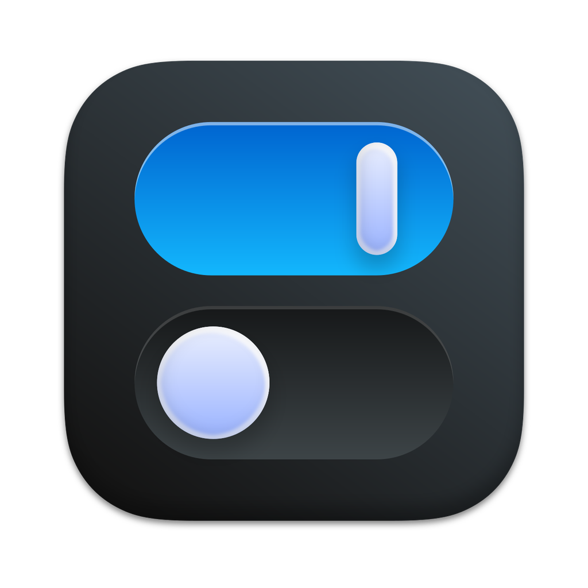
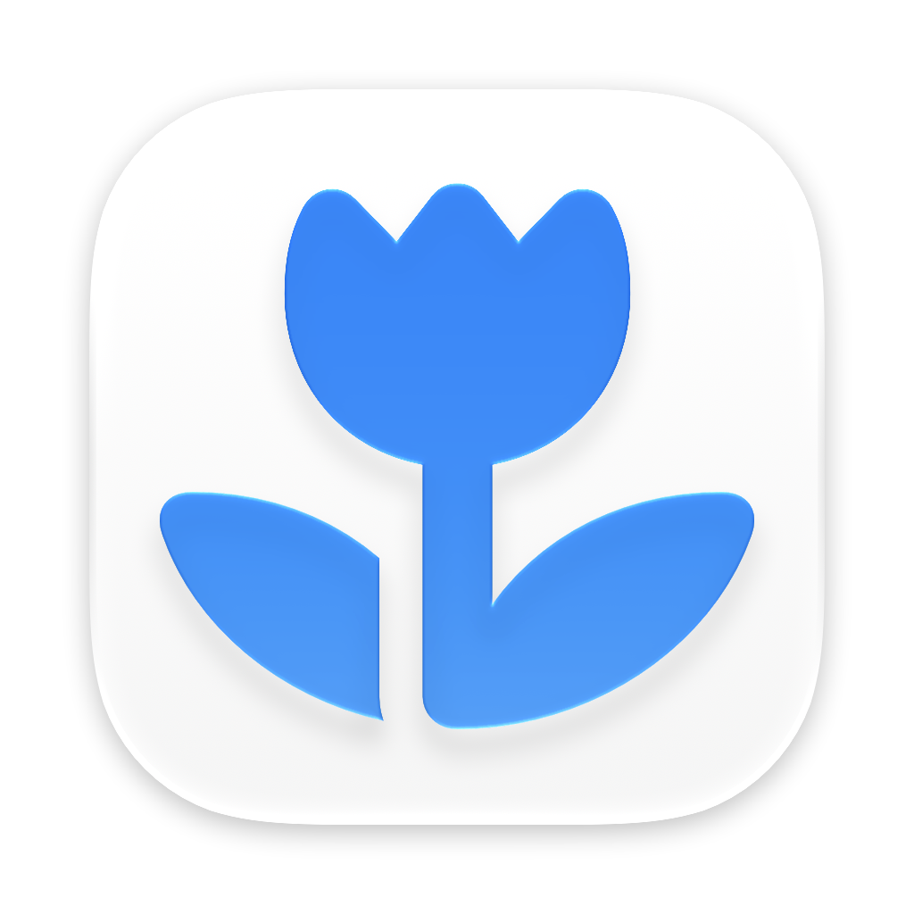
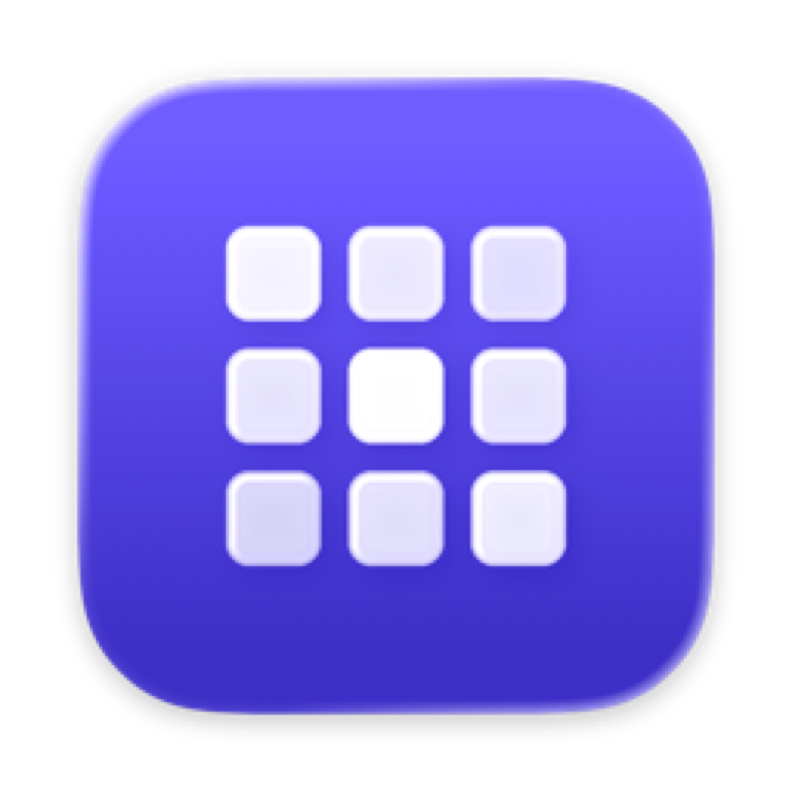

<p align="center">
  
  &nbsp;&nbsp;
  
  &nbsp;&nbsp;
  
  &nbsp;
  
  &nbsp;
  
</p>

<h1 align="center">Tenon Homebrew Tap</h1>

Homebrew casks for macOS apps made by [Tenon Studio](https://tenonstudio.github.io/).

## Install the tap

```bash
brew tap tenonstudio/tap
brew trust tenonstudio/tap
```

## Apps

| App | What it does | Install |
| --- | --- | --- |
| [Flip](https://tenonstudio.github.io/apps/flip/) | Mac system toggles, shortcuts, and custom commands in one menu-bar panel. | `brew install --cask tenonstudio/tap/flip` |
| [Porthole](https://tenonstudio.github.io/apps/porthole/) | Turn any window or screen region into a floating live mirror. | `brew install --cask tenonstudio/tap/porthole` |
| [Tessera](https://tenonstudio.github.io/apps/tessera/) | Live p5.js generative wallpapers for the desktop. | `brew install --cask tenonstudio/tap/tessera` |
| [Launchpad](https://tenonstudio.github.io/apps/launchpad/) | Native application launcher for macOS 26. | `brew install --cask tenonstudio/tap/launchpad` |
| [Bubble](https://tenonstudio.github.io/apps/bubble/) | A selection action bar with native extensions and PopClip migration. | `brew install --cask tenonstudio/tap/bubble` |

Downloads and Sparkle feeds live under `tenonstudio.github.io/apps/<app>/`.

## Flip

```bash
brew install --cask tenonstudio/tap/flip
brew uninstall --cask tenonstudio/tap/flip
```

- **macOS 12.0+** (Monterey).
- **14-day trial**, then a license is required for continued use; there is no subscription.
- Some controls (Low Power, clamshell sleep, high-energy modes) install a **System Helper** and ask for administrator approval once.
- Uninstall the System Helper from Flip's settings before removing the app.
- Current builds may be signed with an Apple Development certificate and are not notarized. If Gatekeeper blocks the first launch, right-click the app and choose **Open**.

## Porthole

```bash
brew install --cask tenonstudio/tap/porthole
brew uninstall --cask tenonstudio/tap/porthole
```

- **macOS 13.0+** (Ventura), Apple silicon.
- **Free** — every feature, no account, no license key.
- Requires Screen Recording permission in **System Settings → Privacy & Security → Screen Recording**; restart Porthole after granting it.
- The app is named **Porthole**; the older Magic Mirror build is no longer the cask target.

## Tessera

```bash
brew install --cask tenonstudio/tap/tessera
brew uninstall --cask tenonstudio/tap/tessera
```

- **macOS 12.0+** (Monterey).
- A menu-bar wallpaper agent running p5.js sketches.
- The app bundles a `wall` command at `Tessera.app/Contents/MacOS/wall` for creating, validating, and packing wallpaper scripts.
- Use **Quit Tessera** from its menu to stop the wallpaper.

## Launchpad

```bash
brew install --cask tenonstudio/tap/launchpad
brew uninstall --cask tenonstudio/tap/launchpad
```

- **macOS 26+** (Tahoe), Universal.
- **Free** — no account or license key.
- Restores the full-screen launcher removed in macOS 26, with pinyin search, folders, compact glass mode, hot corners, F4 and global shortcuts.
- Current builds are ad-hoc signed and not notarized. If Gatekeeper blocks the first launch, right-click the app and choose **Open**.

## Bubble

```bash
brew install --cask tenonstudio/tap/bubble
brew uninstall --cask tenonstudio/tap/bubble
```

- **macOS 14.0+** (Sonoma), Universal.
- **Free** — no account or license key.
- A menu-bar accessory that shows a compact action bar for selected text. It needs Accessibility permission in **System Settings → Privacy & Security**.
- Bubble has its own `.bubbleext` extension ecosystem; existing PopClip extensions are migrated on first use.
- Builds are signed with an Apple Development certificate and are not notarized. If Gatekeeper blocks the first launch, right-click the app and choose **Open**.

## Updates

All five apps use Sparkle for automatic updates, so their casks declare
`auto_updates true`. `brew upgrade` skips them by default; use the in-app
updater, or:

```bash
brew upgrade --cask --greedy tenonstudio/tap/flip
brew upgrade --cask --greedy tenonstudio/tap/porthole
brew upgrade --cask --greedy tenonstudio/tap/tessera
brew upgrade --cask --greedy tenonstudio/tap/launchpad
brew upgrade --cask --greedy tenonstudio/tap/bubble
```

## Notes

- Casks live under `Casks/`; the five icon sources under `assets/` are
  1024×1024 PNGs.
- Appcast feeds:
  - `https://tenonstudio.github.io/apps/flip/appcast.xml`
  - `https://tenonstudio.github.io/apps/porthole/appcast.xml`
  - `https://tenonstudio.github.io/apps/tessera/appcast.xml`
  - `https://tenonstudio.github.io/apps/launchpad/appcast.xml`
  - `https://tenonstudio.github.io/apps/bubble/appcast.xml`
- Report issues in the relevant app repository or email [tenonstudio@163.com](mailto:tenonstudio@163.com).
- 中文说明：[README.zh-CN.md](README.zh-CN.md)

---

Maintained by [Tenon Studio](https://github.com/tenonstudio).
