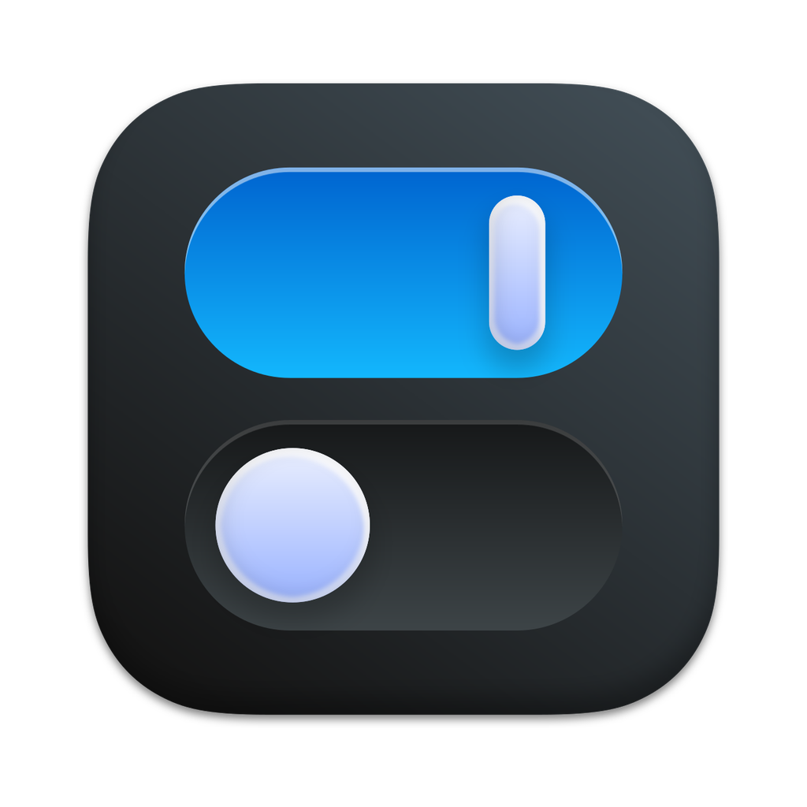
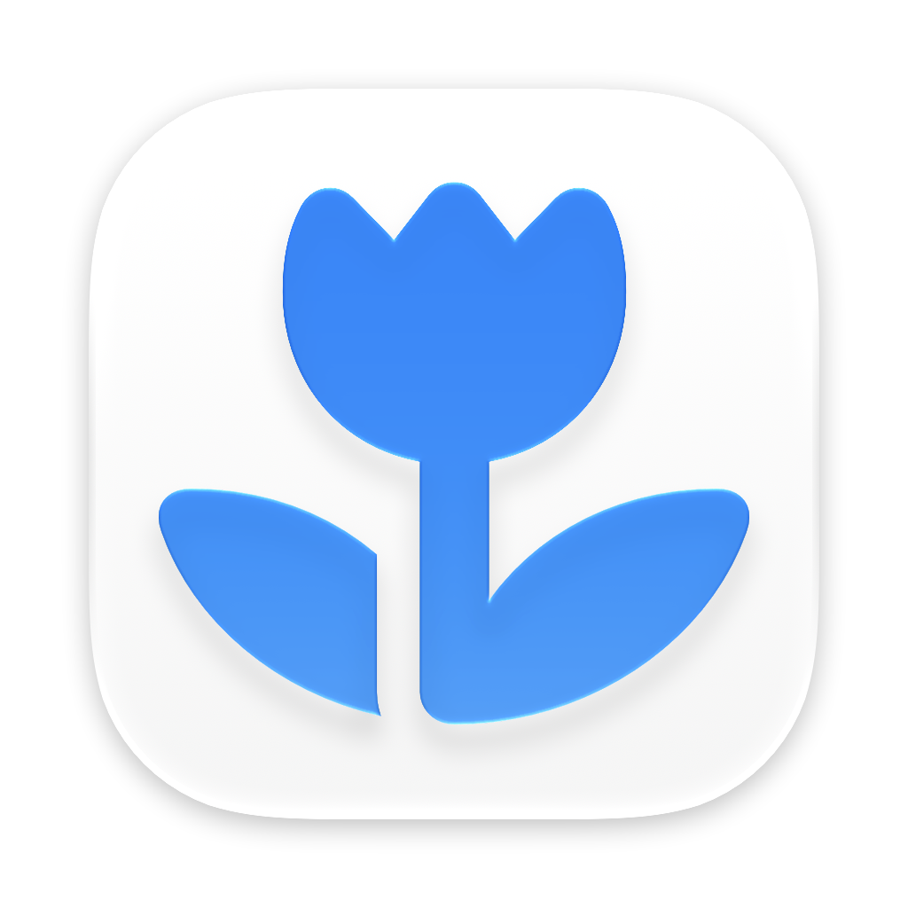

> [English README](README.md)

<p align="center">
  
  &nbsp;&nbsp;
  
  &nbsp;&nbsp;
  
</p>

<h1 align="center">Tenon Homebrew Tap</h1>

Tenon Studio 的 macOS 应用 Homebrew tap。

## 安装 tap

```bash
brew tap tenonstudio/tap
```

## 三个应用

| 应用 | 用途 | Homebrew 状态 |
| --- | --- | --- |
| [Flip](https://tenonstudio.github.io/apps/flip/) | 把系统开关、快捷键和自定义命令收进一个菜单栏面板。 | 可通过 cask 安装 |
| [Porthole](https://tenonstudio.github.io/apps/porthole/) | 把任意窗口或屏幕区域变成实时悬浮镜像。 | 新版本发布后提供 cask |
| [Tessera](https://github.com/tenonstudio/tessera) | p5.js 实时生成艺术壁纸。 | 私有开发中 |

目前只有 **Flip** 可以直接通过 Homebrew 安装。Porthole 和 Tessera 会在新名称的构建发布后加入，不会用旧名称冒充。

## Flip

```bash
brew install --cask tenonstudio/tap/flip
brew uninstall --cask tenonstudio/tap/flip
```

- 系统要求：macOS 12.0+（Monterey）。
- 14 天试用，之后需要 License；不是订阅制。
- 低电量、合盖不休眠、高能耗等功能会安装 **System Helper**，首次使用时请求一次管理员授权。
- 卸载 App 前，建议先在 Flip 设置里卸载 System Helper。
- 当前构建使用 Apple Development 证书签名、未公证。首次打开如遇 Gatekeeper 提示，右键选择「打开」。

## Porthole

Porthole 是 Tenon 的 macOS 窗口镜像应用。旧构建仍托管在旧下载页，但产品和未来的 cask 都使用 **Porthole**。

- 系统要求：macOS 13.0+（Ventura），Apple 芯片。
- 完全免费，无需账号或激活码。
- 首次使用需在「系统设置 → 隐私与安全性 → 屏幕录制」授权。

Porthole 品牌的新 DMG 发布后，会添加 `porthole` cask。

## Tessera

Tessera 是 Tenon 的 p5.js 实时壁纸应用，目前仍在私有开发中，还没有公开的 Homebrew cask。发布后会添加 `tenonstudio/tap/tessera`。

## 更新 Flip

Flip 使用 Sparkle 自动更新，cask 声明了 `auto_updates true`，所以 `brew upgrade` 默认跳过。使用 App 内置更新，或：

```bash
brew upgrade --cask --greedy tenonstudio/tap/flip
```

## 说明

- Cask 文件位于 `Casks/`。
- 问题反馈请到对应应用仓库，或发邮件到 [tenonstudio@163.com](mailto:tenonstudio@163.com)。
- English README: [README.md](README.md)

---

由 [Tenon Studio](https://github.com/tenonstudio) 维护。
