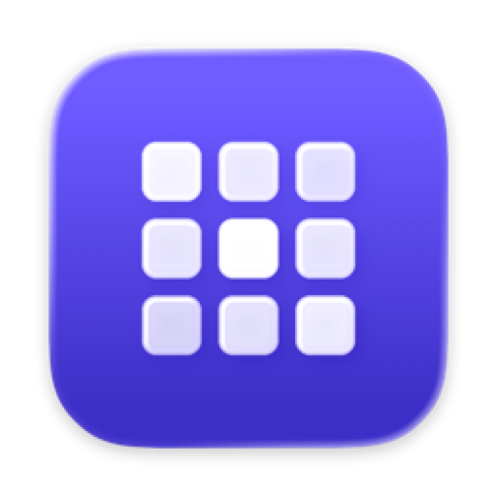

> [English README](README.md)

<p align="center">
  
  &nbsp;&nbsp;
  
  &nbsp;&nbsp;
  
  &nbsp;
  
</p>

<h1 align="center">Tenon Homebrew Tap</h1>

Tenon Studio 的 macOS 应用 Homebrew tap。

## 安装 tap

```bash
brew tap tenonstudio/tap
brew trust tenonstudio/tap
```

## 四个应用

| 应用 | 用途 | 安装 |
| --- | --- | --- |
| [Flip](https://tenonstudio.github.io/apps/flip/) | 把系统开关、快捷键和自定义命令收进一个菜单栏面板。 | `brew install --cask tenonstudio/tap/flip` |
| [Porthole](https://tenonstudio.github.io/apps/porthole/) | 把任意窗口或屏幕区域变成实时悬浮镜像。 | `brew install --cask tenonstudio/tap/porthole` |
| [Tessera](https://tenonstudio.github.io/apps/tessera/) | p5.js 实时生成艺术壁纸。 | `brew install --cask tenonstudio/tap/tessera` |
| [Launchpad](https://tenonstudio.github.io/apps/launchpad/) | 为 macOS 26 重建的原生应用启动台。 | `brew install --cask tenonstudio/tap/launchpad` |

下载与 Sparkle 更新源统一位于 `tenonstudio.github.io/apps/<app>/`。

## Flip

```bash
brew install --cask tenonstudio/tap/flip
brew uninstall --cask tenonstudio/tap/flip
```

- 系统要求：macOS 12.0+（Monterey）。
- 14 天试用，之后需要 License；不是订阅制。
- 低电量、合盖不休眠、高能耗等功能会安装 **System Helper**，首次使用时请求一次管理员授权。
- 卸载 App 前，建议先在 Flip 设置里卸载 System Helper。
- 当前构建可能使用 Apple Development 证书签名、未公证。首次打开如遇 Gatekeeper 提示，右键选择「打开」。

## Porthole

```bash
brew install --cask tenonstudio/tap/porthole
brew uninstall --cask tenonstudio/tap/porthole
```

- 系统要求：macOS 13.0+（Ventura），Apple 芯片。
- 完全免费，无需账号或激活码。
- 首次使用需在「系统设置 → 隐私与安全性 → 屏幕录制」授权，授权后重启 Porthole。
- 应用名称与 cask 都使用 **Porthole**；旧的 Magic Mirror 构建不再是 cask 目标。

## Tessera

```bash
brew install --cask tenonstudio/tap/tessera
brew uninstall --cask tenonstudio/tap/tessera
```

- 系统要求：macOS 12.0+（Monterey）。
- 菜单栏运行的 p5.js 动态壁纸应用。
- 内置 `wall` 命令行工具，路径为 `Tessera.app/Contents/MacOS/wall`，可创建、校验和打包壁纸脚本。
- 使用菜单里的「退出 Tessera」停止壁纸。

## Launchpad

```bash
brew install --cask tenonstudio/tap/launchpad
brew uninstall --cask tenonstudio/tap/launchpad
```

- 系统要求：macOS 26.0+（Tahoe），Universal。
- 完全免费，无需账号或激活码。
- 重建 macOS 26 移除的全屏启动台，支持拼音搜索、文件夹、小窗玻璃模式、触发角、F4 和全局快捷键。
- 当前构建为 ad-hoc 签名、未公证。首次打开如遇 Gatekeeper 提示，右键选择「打开」。

## 更新

四个应用都使用 Sparkle 自动更新，cask 声明了 `auto_updates true`，所以 `brew upgrade`
默认跳过。使用 App 内置更新，或：

```bash
brew upgrade --cask --greedy tenonstudio/tap/flip
brew upgrade --cask --greedy tenonstudio/tap/porthole
brew upgrade --cask --greedy tenonstudio/tap/tessera
brew upgrade --cask --greedy tenonstudio/tap/launchpad
```

## 说明

- Cask 文件位于 `Casks/`；`assets/` 下四张图标统一为 1024×1024 PNG。
- Appcast：
  - `https://tenonstudio.github.io/apps/flip/appcast.xml`
  - `https://tenonstudio.github.io/apps/porthole/appcast.xml`
  - `https://tenonstudio.github.io/apps/tessera/appcast.xml`
  - `https://tenonstudio.github.io/apps/launchpad/appcast.xml`
- 问题反馈请到对应应用仓库，或发邮件到 [tenonstudio@163.com](mailto:tenonstudio@163.com)。
- English README: [README.md](README.md)

---

由 [Tenon Studio](https://github.com/tenonstudio) 维护。
